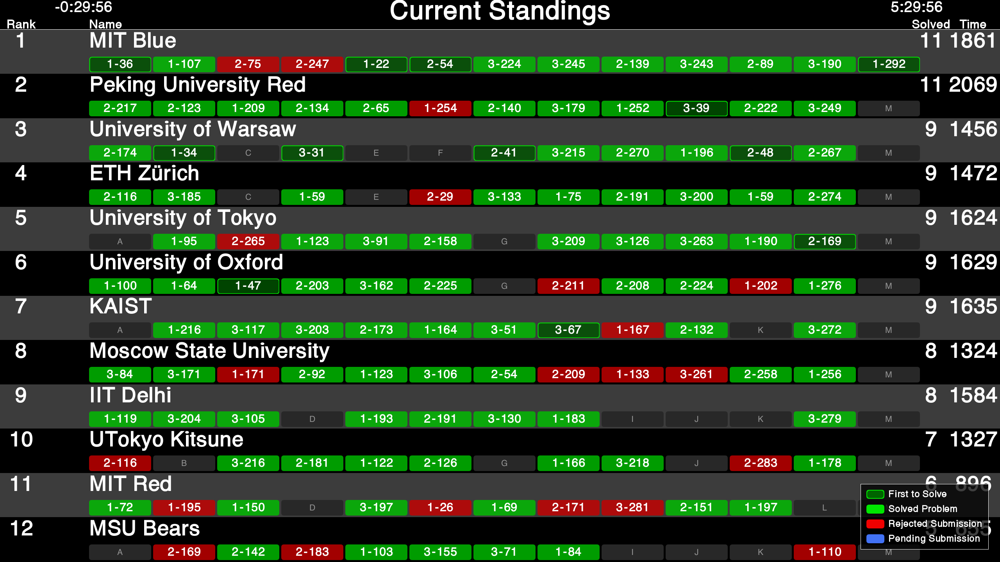
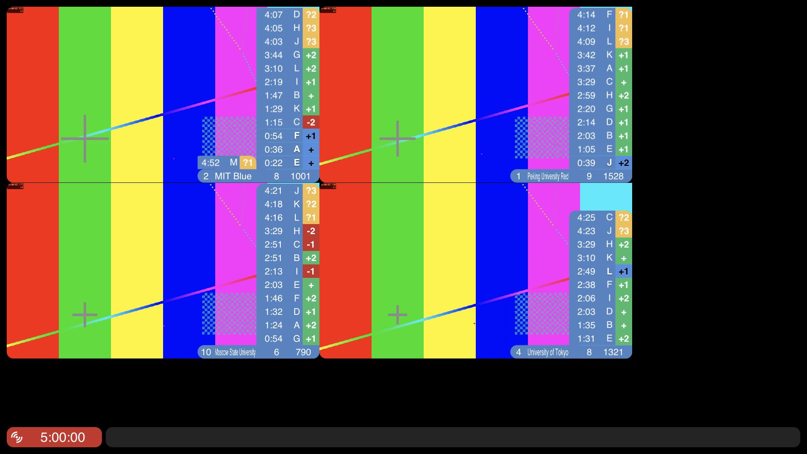

# Ollama UI 与原版输出回归

日期：2026-10-30。此记录对应当前功能分支，尚未发布版本。

管理页面采用 [Ollama 设计参考](https://getdesign.md/ollama/design-md)：白色背景、黑色主按钮、胶囊控件、细边框和简洁中文。首页、Live、PresentationAdmin 和 Resolver 五页配置使用同一套控件。Resolver 的滚榜渲染器保持原有样式。

Live 使用 [Live-v3 的指定提交](https://github.com/icpc/live-v3/tree/200c82f81ffdea91ffec9cc17b314ffc72436a0f)中的 React 视觉组件，保留原版坐标、字体设定、配色、队伍布局、Ticker 和 Queue。适配文件及原始哈希见 `frontend/vendor/icpc-live/UPSTREAM.json`。调整集中在媒体传输、数据映射、缩放测量、同队伍设置更新及内存字体缓存。

大屏模板按 [ICPC Tools v2.6.1331](https://github.com/icpctools/icpctools/tree/v2.6.1331) 重建几何和动画；数字时钟使用原版多边形，英文文字使用官方 Helvetica 的 Java 字形轮廓与整数度量。Java 仅用于生成资产和参考截图，部署不依赖 Java。

## 功能回归

| 范围 | 本轮检查 |
|---|---|
| 自动测试 | 177 项通过，语法、TypeScript 和生产构建通过；依赖审计 0 个已知漏洞 |
| 管理界面 | 桌面、375px 手机、模块导航、键盘关闭菜单、表单标签、下拉框及按钮 |
| Resolver | 18 队事件流、工作区快照、校徽与照片保存、冠亚季军与最快解题奖、2K/4K、完整 122 步手动滚榜、观众同步、回退和恢复 |
| 实时赛事 | 真实 HTTP Basic 事件流、重判、重复事件、删除、重启后的 `since_token` 续传；公开数据仍隐藏封榜判题 |
| Live | 单队伍、双队伍、四分屏；同一队伍修改布局/来源；摄像头与桌面画中画；预览静音；独立音频选择与音量；预览和正式画面隔离 |
| 叠加组件 | 八类组件、位置修改、恢复原版位置、素材、布局预设和透明输出；透明输出保留四队伍信息且不加载视频；PNG 实测透明区域 alpha=0，图形 alpha=255 |
| 媒体播放 | RTSP、RTMP、SRT、HLS 和 HEVC MP4 实流接入；四路 1920×1080 视频；WebRTC 播放及阻断 WHEP 后四路 HLS 回退；源断开占位与恢复 |
| 展示管理 | 10 个独立身份配对、命名、分组、缩略图；节目单保存、排序、下发、暂停/继续、上一项/下一项、黑屏/恢复 |
| 模板 | 11 类基础模板及 Resolver / Live 适配器实际上屏；4K、32:9 渲染为 7680×2160，刷新后设置保留 |
| 容器 | amd64 与 arm64 构建；amd64 仿真容器通过 Resolver / 平台冒烟和保留数据重启检查 |
| 恢复 | 服务重启保留工作区、绑定、节目和滚榜会话；大型展示缓存改为异步 IndexedDB，兼容旧缓存与不可用存储 |

本轮修复了多窗口 SSE 连接占满、晚加入观众漏步骤、同队伍媒体/布局不更新、大屏连续操作版本冲突、视频首次加载卡死、判题队列历史重放/删除残留和大图同步回读等问题。滚榜进度、长期展示身份及配置存储键保持兼容。

## 像素对照与边界

使用官方 Java 发行包离屏渲染，在相同赛事、时间和尺寸下与浏览器 PNG 对比。覆盖榜单、领先榜、时钟、倒计时、公告、首解、空判题队列和校准，共 24 个样本（1080p、1440p、2160p）。原始指标见 [ollama-pixel-comparison.json](ollama-pixel-comparison.json)。

| 2K 样本 | 平均每通道绝对差值（0–255） |
|---|---:|
| 时钟 | 0.076 |
| 倒计时 | 0.077 |
| 公告 | 0.574 |
| 首解 | 1.819 |
| 榜单 | 4.844 |

这些结果验证原版布局与字形的接近程度，不代表逐字节相等。浏览器与 Java 的抗锯齿、透明度舍入和图片缩放仍有细微差异；中文使用系统字体回退。队伍介绍、Logo、轮播及动态提交通过功能检查，尚未做所有动态帧的 Java 像素一致验收。Live 复用原版组件，尚未制作独立原版服务的同帧截图基准。

## 未通过的发布门槛

- 多屏规模验收未通过。测试环境为 Apple M4 / 16 GiB，Docker arm64 8 vCPU / 7.75 GiB；10 个浏览器展示页与四路预编码 1080p30 测试视频共享同一台电脑，网络为回环。完成的一轮 100 个控制样本 P95 为 4095ms，四次预约切换偏差为 314、107、98、16ms；后续异步缓存复测出现等待回执超时。不能将这些结果解释为达到 500ms / 100ms 门槛，也不能用历史平台验收指标替代本轮结果。采样见 [ollama-performance.json](ollama-performance.json)。
- OBS 32.0.4 的原生场景切换再次触发 macOS Qt/AX 崩溃。本轮新渲染器的 OBS 验收未完成；已确认原场景配置仍为“场景”，未开启推流或录制。
- 未完成十台物理展示电脑、场馆网络、实际 LED 控制器及长时间稳定性验收。

Browser 插件完成前半段交互和截图；其页面控制连续超时后，剩余交互使用备用 Playwright。临时测试数据、视频和脚本使用隔离的 QA 服务。

