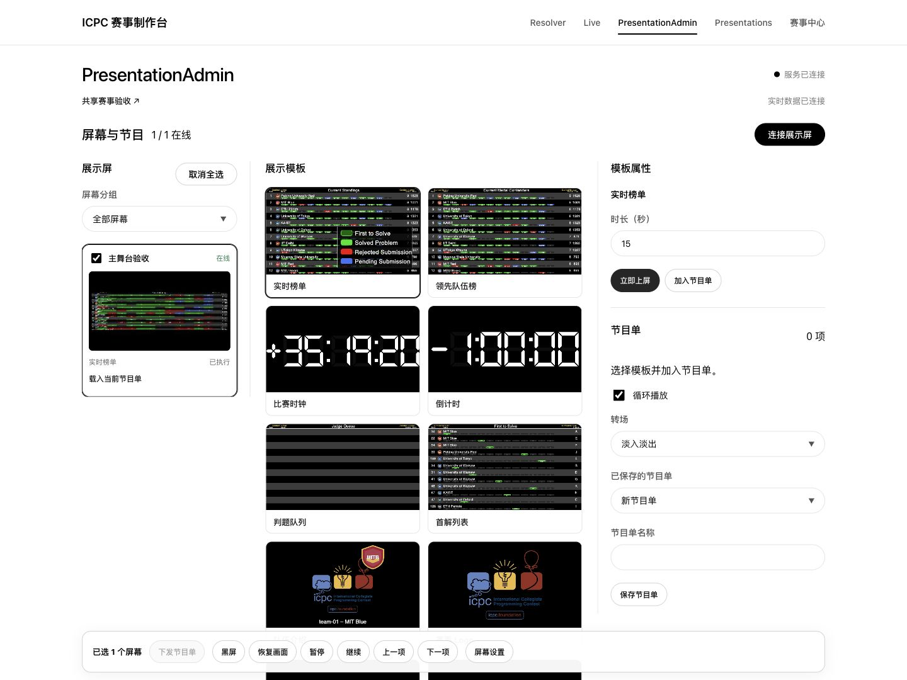

# 共享赛事与管理流程验收

日期：2026-10-30。本记录对应 `codex/production-platform` 的本地改造，尚未发布版本。历史平台基线见 [PLATFORM-VALIDATION.md](PLATFORM-VALIDATION.md)。

管理页面沿用 [Ollama 设计参考](https://getdesign.md/ollama/design-md)的白底、黑色主按钮、圆角控件与细边框。首页仍为四个入口，公共配置集中到赛事中心；Live 保留预览、正式画面并排，PresentationAdmin 按屏幕、模板、属性与节目单组织。

## 本轮功能检查

交互验收使用 Browser 插件及其 IAB，容器、接口与自动测试使用隔离数据目录。测试视频为合成图样，没有连接外部直播平台。

| 范围 | 结果与证据 |
|---|---|
| 自动回归 | 204 项测试全部通过；JavaScript 语法、TypeScript 和生产构建通过。包含原 Resolver 回归及新增共享流程用例。 |
| 共享赛事 | 一次配置供 Live 与展示管理使用；新建、编辑未启用赛事不切换当前赛事，显式切换清理队伍、媒体及临时通知。实际 Basic HTTP 持续流只保留一条服务端连接；停止、恢复保留凭据与游标。 |
| 数据源替换 | 同工作区更换地址或比赛 ID 后重置公开解榜、清空旧引用并重建输出上下文；凭据修改及重连保留上下文。重启后保持正确状态，公开响应继续隐藏封榜判题。 |
| 连接表单 | 无认证 / Basic / Bearer 条件字段；测试当前未保存内容，错误反馈明确；密码留空保留。实时事件不覆盖配置草稿，竞争保存返回版本冲突。 |
| 素材与媒体 | 赛事 Logo、学校校徽、队伍照片保存；自动校徽及 ICPC 回退；素材随 Resolver 快照复制。媒体按赛事显示，支持搜索、编辑、备用来源、私有地址与高级参数。 |
| Resolver | 从已保存 CCS 获取完整赛后快照并下载 NDJSON；手动上传同一归档完成解析，18 队、13 题、60 分钟封榜、20 次揭晓。本轮完整手动推进 94/94 步，主持与观众在 31、61、94 步同步；第 31 步重启服务并刷新恢复，结束后回退及重进正常。更换共享数据源后原滚榜仍为 94/94。 |
| 获取完整性 | 有限 Contest API 快照二次比较提交与判题，无需先公开解榜；持续流处理结束标志、重判、删除及重复事件。取消、缺少最终判题、未结束或变化中的快照不覆盖旧滚榜；归档重启后可下载。 |
| Live | 预览与正式输出隔离，保存预览不会上屏；备用源仅修改预览，明确 Take 后才改变正式输出。搜索队伍、预设更新、另存为与独立输出规格完成检查。 |
| 控制栏 | 全屏进入、退出及权限拒绝提示；隐藏后点击画面、节目切换和刷新不恢复，H 与透明热区恢复。全屏被拒绝时保留控制栏。`clean=1` 无控制栏、热区与管理通知。 |
| 展示管理 | 配对、命名、分组、多选、节目单更新、排序、下发、暂停、继续、上一项、下一项、黑屏和恢复；重新配对不残留黑屏。11 种基础模板及 Resolver / Live 适配器实际上屏。 |
| 输出与回传 | 默认 2K，各屏保存独立规格；4K、32:9 实际画布为 7680×2160，刷新恢复。修复宽屏缩略图固定 16:9 拉伸，回传包含输出区域、安全边距与留黑。 |
| 协议与编码 | RTSP 四路、RTMP、SRT、HLS 与 HEVC MP4 实际播放通过；协议样本 320×180，规模样本为四路 1080p。HEVC 输入由 FFmpeg 工作服务自动转码；本轮 Browser 使用 HLS 回退。[独立记录](ollama-media-playback.json)。 |
| 透明叠加 | 浏览器输出保留四队信息，零视频元素、零控制元素；1920×1080 PNG 中 1,721,492 像素 alpha=0，347,125 像素 alpha=255。 |
| 恢复 | 分别重启应用、媒体工作服务及网关；十屏名称、绑定、节目、执行回执恢复。源断开后占位，外部发布者重新连接后四路 1920×1080 视频恢复播放。 |
| 部署 | arm64 原生与 amd64 仿真镜像构建；两种架构实际容器通过 Resolver / 平台冒烟及保留数据重启检查。从公开 v1.3.0 镜像保存数据卷升级后，预设、主持恢复、观众链接和滚榜进度正常。 |
| 页面 | 桌面及 375px 宽手机检查，菜单支持 Escape 关闭，无横向溢出；最终管理界面截图如下。 |

## 十屏与四路视频

环境为 Apple M4（10 核、16 GiB），Docker Desktop arm64 分配 8 vCPU / 7.75 GiB；10 个 Browser IAB 展示文档均为 visible，画布 2560×1440；另一个正式输出同时播放四路 1920×1080 / 30fps 预编码运动测试视频。网络为同机回环，视频经 RTSP 接入并使用 HLS 浏览器回退。

使用 SSE 观察真实帧绘制回执，没有通过接口伪造展示端回执。100 个控制样本 P95 **264.5ms**，最大 **268.5ms**；四次提前 750ms 预约切换，跨屏偏差分别为 **28、3.5、27、22.5ms**。本机记录达到 P95 ≤500ms、切换偏差 ≤100ms 的指标。

[原始采样](ollama-performance.json)保留了此前失败的一轮（P95 4095ms）及后续回执超时记录。本轮结果不代表十台物理电脑、场馆局域网、实际 LED 控制器或长时间运行已完成验收。缩略图修复后另做宽屏实际画面检查；16:9 规模样本的尺寸及捕获路径保持一致。

## 原版画面与像素对照

Live 复用 [Live-v3 指定提交](https://github.com/icpc/live-v3/tree/200c82f81ffdea91ffec9cc17b314ffc72436a0f) 的视觉组件，原始哈希及适配范围见 `frontend/vendor/icpc-live/UPSTREAM.json`。大屏以 [ICPC Tools v2.6.1331](https://github.com/icpctools/icpctools/tree/v2.6.1331) 的几何、数字多边形及 Java 字形度量为依据；Resolver 原滚榜渲染器保持原样。

相同赛事、时间、尺寸下，对官方 Java 离屏参考与浏览器原始 Canvas PNG 比较，覆盖 8 种模板 × 1080p / 1440p / 2160p，共 24 个样本。使用 Browser 的 CDP 读取原始 Canvas，避开 macOS 原生截图的色彩转换。[指标文件](ollama-pixel-comparison.json)保留逐项差异。

| 2K 样本 | 平均每通道绝对差值（0–255） |
|---|---:|
| 时钟 | 0.076 |
| 倒计时 | 0.077 |
| 公告 | 0.574 |
| 首解 | 1.819 |
| 榜单 | 4.844 |

这些结果不是零像素差异：浏览器与 Java 的抗锯齿、透明度舍入和缩放有差别，中文使用系统字体回退。队伍介绍、Logo、轮播与动态提交已做功能检查，尚未穷举动态帧；Live 尚无独立原版服务的同帧截图基准。

## 尚未通过的发布门槛

- OBS 32.0.4 的“添加来源”菜单未能通过原生工具打开；再次切换验收场景时 OBS 崩溃，恢复正常模式后已选回原来的“场景”和 macOS 屏幕采集。未开启推流或录制，未上传崩溃报告。本轮 OBS 浏览器源验收未通过，需要人工完成实际接入。
- 本轮四路规模视频验证了 HLS 播放及恢复，没有据此宣称四路 WebRTC 已验收。其他协议与编码的独立检查结果单独记录，不用历史通过记录代替本轮观察。
- 十台物理展示电脑、真实场馆网络、LED 控制器和长时间稳定性测试仍需现场完成。

在上述发布门槛完成前，不创建新版本或推送发布标签。
