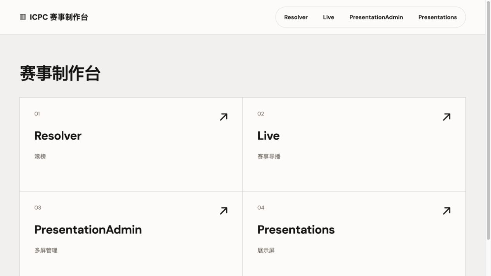
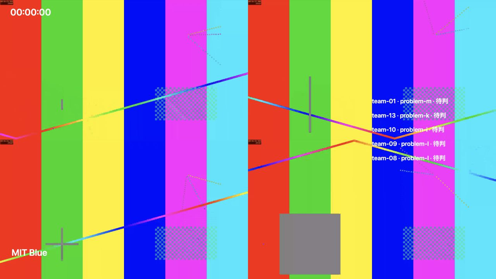
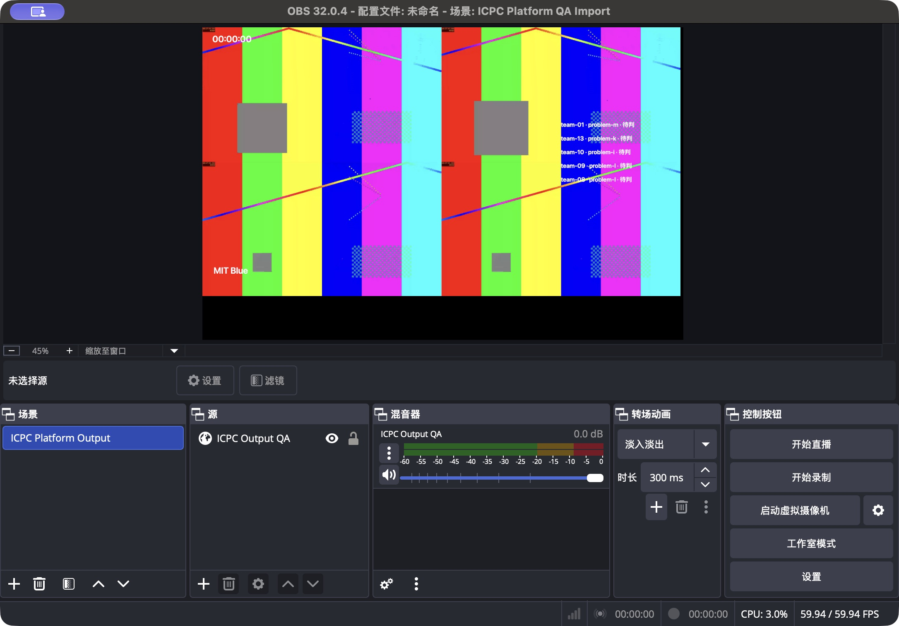

# 平台本地验收记录

此文记录 UI 改造前的基线。新版画面、回归结果与未通过项见 [OLLAMA-VALIDATION.md](OLLAMA-VALIDATION.md)。

日期：2026-10-30。代码基线为 Resolver Web v1.3.0，平台改造在 `codex/production-platform` 分支；本记录不代表已经发布新版本。

## 环境与范围

- Apple M4，10 核，16 GiB 内存，macOS；Node.js 24。
- Docker Desktop：Linux arm64，8 vCPU、7.75 GiB 内存。amd64 镜像在同一机器上通过仿真运行。
- Browser 插件 IAB，10 个独立展示身份，Canvas 为 2560×1440。测试时启用前台渲染模拟，避免后台标签页节流；测试后移除临时页面。
- 同时运行独立正式输出，输入为 4 路 FFmpeg 合成测试信号：1920×1080、30 fps、H.264、约 1.5 Mbps/路。
- 网络为本机回环及 Docker 网络。未用十台物理展示电脑和实际场馆网络测试，也未做长时间稳定性或四路同时转码的容量承诺。

## 已验证结果

| 项目 | 结果 |
|---|---|
| 自动回归 | 160 项通过，其中包含原有 137 项回归；语法检查与 TypeScript 检查通过 |
| 依赖检查 | `npm audit` 为 0 个已知漏洞 |
| 数据接入 | 真实 HTTP Basic Contest API 持续事件流接入；重判、删除、重复 token、服务重启后 `since_token` 续传通过 |
| 封榜 | 私有判定为通过/未通过时，公开响应仍为待判；榜单、首解及队列共用服务端过滤后的视图 |
| Resolver | 从共享工作区生成独立快照；保留手动主持、原榜单画面、观众链接与进度恢复；展示模板可跟随 Resolver 观众画面 |
| 基础模板 | 11 种基础模板完成浏览器轮播，无运行错误；Resolver 和 Live 适配器分别验证 |
| 多屏 | 实际配对 10 个浏览器展示身份，名称、分组、节目、缩略图与回执独立；刷新与服务重启后保持绑定 |
| 导播 | 预览与正式画面独立；四分屏正式输出可显示 4 路 1080p 视频；OBS 浏览器来源已实际显示四路画面 |
| 协议和编码 | RTSP、RTMP、SRT、HLS、MP4 接入通过；HEVC MP4 经自动兼容转码后在浏览器播放 |
| 回退与故障 | 屏蔽 WebRTC 接口后 HLS 持续播放；媒体网关/工作服务重启后自动恢复；应用断开期间展示保留节目，重连后恢复最新状态 |
| 输出 | 透明输出 PNG 的空白区域 alpha=0；4K / 32:9 的 Canvas 为 7680×2160；375px 宽管理页面无整页横向溢出 |
| 升级 | 使用真实 v1.3.0 镜像写入预设及滚榜进度，保留同一数据卷升级；原主持恢复、观众进度及新平台绑定在重启后均保持 |
| 容器 | amd64、arm64 应用及媒体工作服务镜像构建、Compose 启动和健康检查；两种架构的 API/恢复 smoke 通过 |
| 部署包 | 打包测试验证应用/工作服务镜像配置、MediaMTX 配置、指南、旧版 Resolver PDF 标注及 SHA256 校验 |

OBS 32.0.4 在辅助功能自动化切换场景集合时出现 Qt/AX 崩溃；正常载入测试集合后四路画面显示正确。测试未开启录制或对外推流，原有场景集合和场景已经恢复。隔离的 QA 场景集合保留供复查。

## 延迟测量

在上述 10 个展示页和独立四路正式输出同时运行的条件下：

- 黑屏/恢复共 10 轮，得到 100 个展示端 Canvas 帧回执。
- 指令生效延迟 P95 **289.5 ms**，最大 **301.5 ms**。
- 4 次预约切换的屏间偏差分别为 **12、7、13、9 ms**，最大 **13 ms**。
- 预约提前量为 750 ms；偏差按展示端校准时钟后的帧回执计算，未测量物理 LED 控制器或显示器的扫描延迟。

完整采样见 [platform-performance.json](platform-performance.json)。场馆部署仍需使用实际显示电脑、网卡、交换机和 LED 控制器复测。

## 复现入口

```bash
npm ci
npm run check
npm test

# 在隔离数据卷的服务上执行，会创建验收赛事、屏幕和节目。
RESOLVER_ADMIN_KEY=测试管理员密码 node scripts/smoke-platform.mjs http://127.0.0.1:4173
# 重启同一服务、保留同一数据卷后：
RESOLVER_ADMIN_KEY=测试管理员密码 node scripts/smoke-platform.mjs http://127.0.0.1:4173 verify-restart
```

完整部署与现场使用见 [PLATFORM.md](PLATFORM.md)。GitHub Actions 已增加两种架构的应用/媒体镜像构建与恢复检查；本次仅完成本地验证，尚未推送、运行远端流水线或发布标签。

## 实际画面






