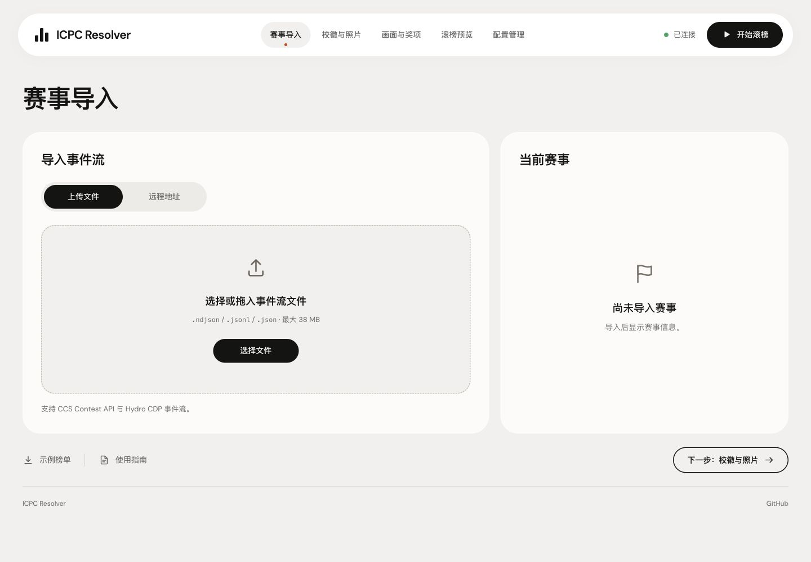
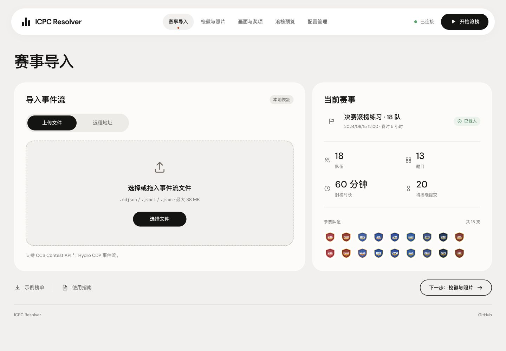
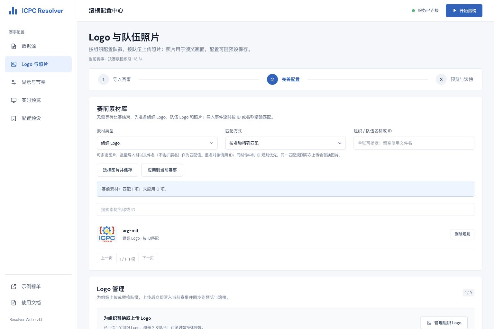
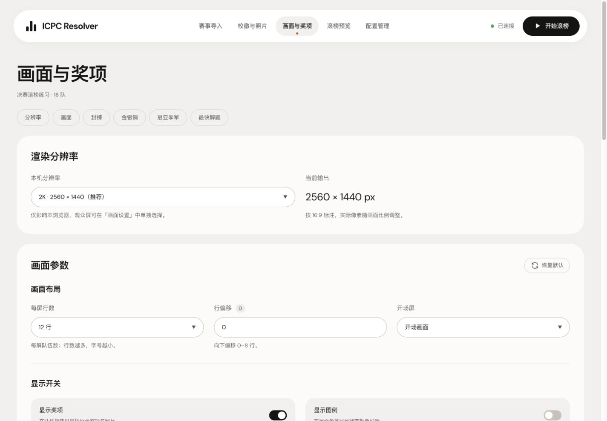
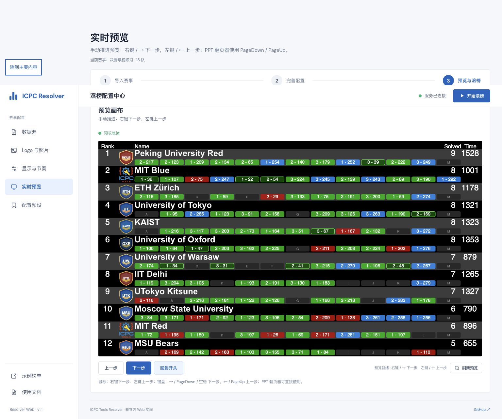
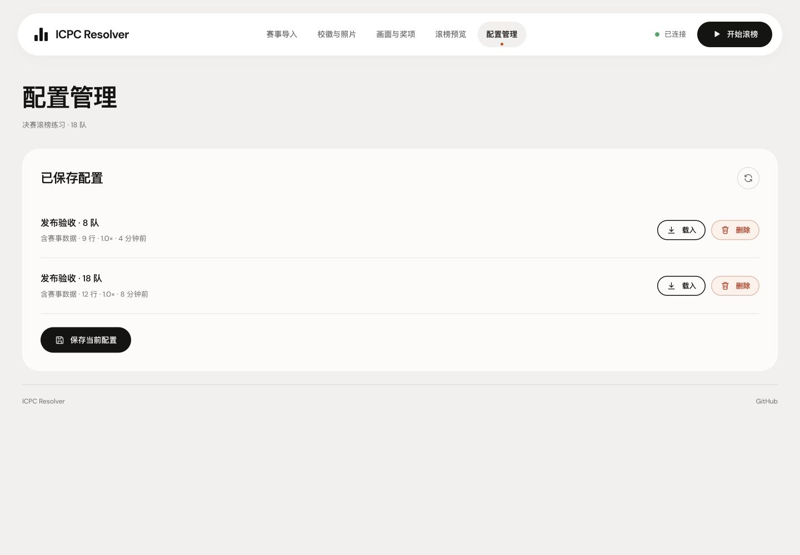
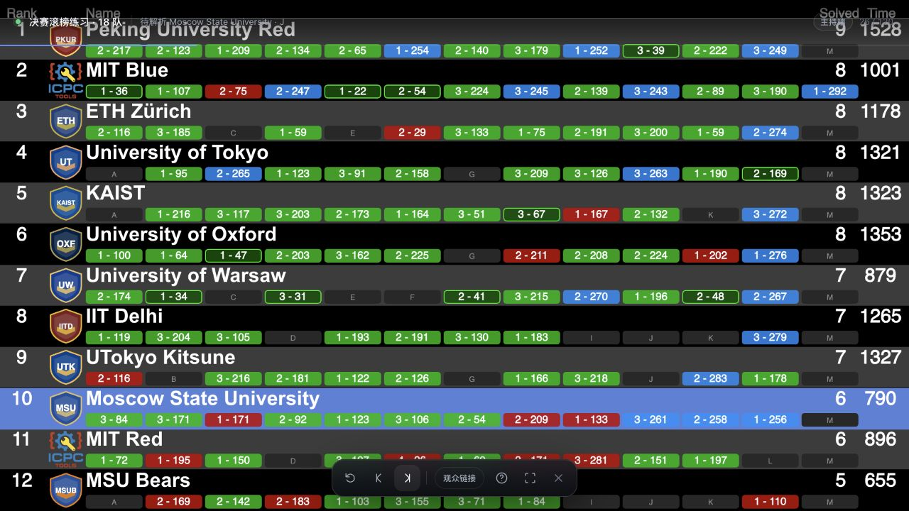
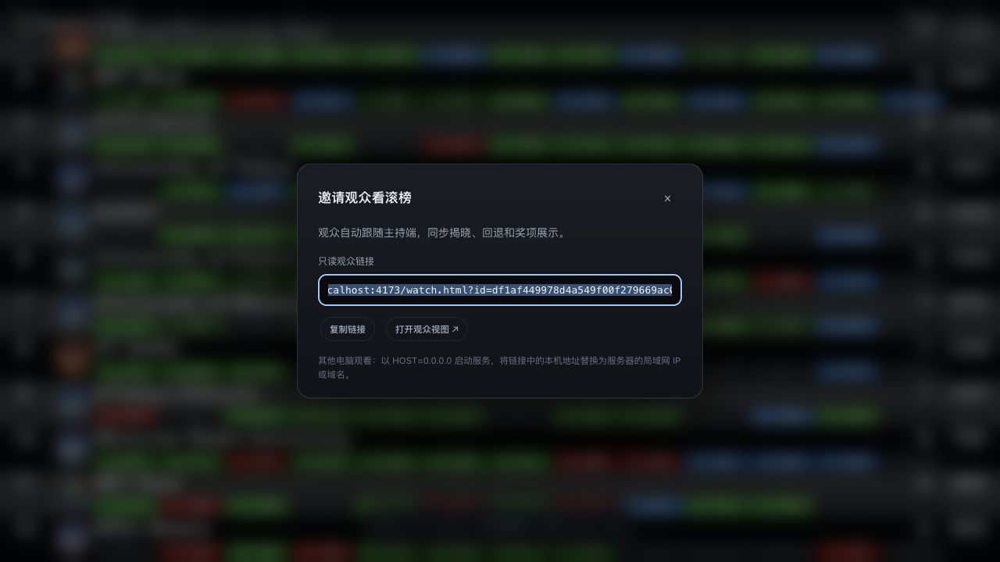

# Resolver Web 图文使用指南

版本 1.1.0 · 2026-10-26

适用于赛事主持人、现场转播操作员和部署管理员。配置界面采用蓝白侧栏布局，滚榜画面继续使用原有 ICPC Resolver 样式。本指南中的截图均来自本版本的 Browser 实测，示例成绩为合成练习数据。

## 1. 打开配置中心

本机运行 `npm ci`、`npm start`，访问 `http://127.0.0.1:4173/`。服务器部署请先阅读仓库 README 的部署教程。管理员密码启用后，浏览器登录用户名固定为 `admin`。

左侧五个页面对应数据、素材、显示、预览和预设。顶部显示服务状态；点击状态可重新检测连接。首次打开不包含任何演示赛事，也不会联网自动下载示例。

想先练习时，点击「示例榜单」进入 GitHub。建议下载快速上手或决赛样例；ZIP 先解压。所有示例均通过普通上传入口导入。

## 2. 导入赛事事件流

进入「数据源 → 上传文件」，点击选择或拖入 `.ndjson`、`.jsonl`、`.json` 文件，原始事件流最大 38 MB。上传解析成功后，当前赛事区域显示名称、队伍数、题目数、封榜时长和待定提交数。

Hydro：在比赛榜单导出 CDP 包，解压后选择 `event-feed.ndjson`。支持 ACM/XCPC 赛制；OI/IOI 计分制不适用。不要上传整个 ZIP，或只有最终汇总成绩的 CSV / Excel。

远程来源：切到「远程地址」，填写文件完整 HTTP(S) 地址，再点「获取并解析」。默认只允许公网 80/443 端口；局域网 CDS 需要部署管理员设置精确来源白名单。

重新导入会先确认替换，并提供一次「撤销载入」机会。此时不会修改已经开始的独立滚榜会话。

## 3. 准备 Logo 与照片

导入榜单后，会按学校中文名、英文名及别名自动匹配 [Hydro 学校 Logo 库](https://avatar.hydrooj.com/)。未匹配到学校或校徽加载失败时，统一显示 ICPC 官方 Logo。学校索引随项目附带，断网仍可导入；已有的赛事 Logo、赛前素材和手工上传图片继续优先使用。「Logo 管理」会显示自动匹配数量，并区分「自动匹配」「ICPC 默认」和手工覆盖。

「Logo 与照片」可在赛前独立准备素材库。选择组织 Logo、队伍 Logo 或队伍照片；按名称或 ID 匹配，填写匹配值，再选择图片保存。多选时使用不含扩展名的文件名匹配。

同名对象请用 ID。同一对象同时命中时，ID 规则优先。导入事件流后自动匹配，也可以点击「应用到当前赛事」。查看未匹配报告，补齐缺失或重名项目。

「管理组织 Logo」可为某组织统一替换徽标；下方队伍列表可设置独立队伍 Logo 和照片。榜单优先使用队伍 Logo，组织 Logo 与照片用于颁奖。上传后请在预览确认图片位置；照片需要开启「显示奖项」。

图片保存在服务端数据目录，保存预设时记录其引用。迁移服务时必须同时备份预设、素材规则和图片目录。

## 4. 设置显示、封榜与奖项

每屏可选 9、12 或 15 行；行偏移用于转播留白。开场屏可选 Logo 开场或直接显示榜单。标题留空保持原版无标题画面。

默认读取事件流的封榜记录，必要时恢复历史封榜时间。赛后已经解封的完整事件流也可选择「手动还原封榜」，填写最后多少分钟。例：5 小时比赛、最后 60 分钟封榜，即从第 240 分钟开始隐藏提交，随后逐题揭晓。

选择自定义金银铜后可设置各等级名额和名称，0 表示关闭该等级。「同题数、同罚时获得相同奖项」按累计名额划线；跨奖线的并列组取较高奖项，因此人数可能增加。打星队伍不占正式名次与奖项名额。点击「预览获奖名单」核对实际队伍。

「自动生成冠亚季军」按最终榜单顺序，为前三支正式队伍分别颁发冠军、亚军和季军，名称可以修改，可与金银铜同时使用。正式队伍不足三支时按实际数量颁发；并列时按最终榜单顺序分配这三个名额。

「各题最快解题奖」可沿用事件流，也可为全部题目或勾选的指定题目生成，例如「A 题最快解题奖」。按最早通过（AC）的比赛时间计算，使用完整时间精度，不含罚时；时间完全相同则共同获奖。默认只计算正式队伍，开启「包含打星队伍」可让打星队伍参与。无人通过的题目，以及存在更早或同一时间的未判定提交的题目，暂不颁发。自定义生成会替换事件流中同类奖项，其他奖项保留。

点击「预览全部获奖名单」可同时核对金银铜、冠亚季军和各题最快解题奖。开启自定义冠亚季军或最快解题奖会自动启用「显示奖项」；配置可随本地恢复和配置预设保存。

比赛必须保留完整提交时间和判题记录；只有最终汇总榜单无法重建滚榜。修改输入后点击其他位置提交更改，再检查预览。

## 5. 手动预览

进入「实时预览」，等待「预览就绪」。画布与正式播放使用同一引擎和渲染器，比例为 16:9。

使用画布下方的「下一步」「上一步」「回到开头」排练。也可在画布内使用右键/左键或翻页键。检查冻结榜、待定题目、揭晓、排名跃升、获奖队伍和图片。

预览不会向正式观众发布进度。需要重新生成时点击「刷新预览」。预览失败先看具体错误、确认服务连接，再检查数据格式与封榜配置。

## 6. 保存与载入预设

「配置预设 → 保存当前配置」，输入便于辨认的名称，保存后列表显示是否包含赛事数据。预设保存在服务端，可在同一部署的其他浏览器载入。

载入预设会确认覆盖，并保留一次可撤销备份。换电脑、关闭浏览器或升级前先保存；仅存在浏览器本地存储的当前赛事不能代替服务端备份。

## 7. 主持正式滚榜

点击顶部「开始滚榜」，新标签页打开主持端。建议用电脑和投影设备，并在开场前确认全屏、分辨率及翻页器。主持端和预览相互独立。

| 控制 | 操作 |
| --- | --- |
| 下一步 | 右键 / → / ↓ / PageDown / 空格 / Enter |
| 上一步 | 左键 / ← / ↑ / PageUp / Backspace |
| 回到开头 / 跳到结尾 | Home / End |
| 重置 / 全屏 / 帮助 | R / F / ? |
| 关闭帮助或分享 / 退出全屏 | Esc |

鼠标操作作用于画布，不影响配置页的常规点击。首次从冻结榜单点击下一步，约 650 毫秒滑到底部。启用「显示奖项」后，系统从所有活动奖项（金银铜、冠亚季军、各题最快解题奖及其他未忽略奖项）中找到获奖队伍最靠下的封榜位置；此位置之前的滚榜动作自动以 4 倍速快速掠过，到达奖项区后停下，恢复逐步手动推进。若排名变化把获奖队伍挤到更低位置，会提前停止快进，避免跳过该队。没有活动奖项时从底部手动滚榜。

快进期间可点击「暂停 4 倍速」或按 Esc 暂停，也可继续快进；回退、重置会取消自动推进。全屏时底部工具栏会自动隐藏，鼠标接近底部可再次显示。

## 8. 分享只读观众链接

观众可直接打开固定 `/view` 地址，页面自动等待并接入当前正式滚榜，无需登录；主持人开始新场次后自动切换。预览和素材配置不会抢占直播。也可在主持端点击「观众链接」复制固定入口；「仅观看本场滚榜」提供 `/view?id=...` 链接。旧 `/watch.html?id=...` 链接仍可使用。主持链接带有控制权限，勿分发。

观众会自动同步前进、回退、重置和颁奖，刷新或晚加入可恢复当前进度；观众无推进按钮。服务只下发已经公开的步骤，不提前暴露未来判题和奖项。

跨电脑访问必须使用服务器局域网 IP 或域名，不能分发 localhost / 127.0.0.1。推荐主持人一开始就通过这个相同地址登录。公网使用 HTTPS，反向代理关闭 SSE 缓冲并保留 Host 头，详细配置见 README。

## 9. 收尾、备份与常见问题

| 现象 | 处理 |
| --- | --- |
| 服务未连接 | 检查 Node / 容器状态及端口，点击顶部状态或重试连接 |
| 管理页面返回 401 | 使用用户名 admin 和部署时配置的管理员密码 |
| 域名或局域网返回 403 | 设置 RESOLVER_ADMIN_KEY，反向代理保留原始 Host |
| 没有需要揭晓的提交 | 检查提交时间和判题是否完整，必要时手动还原封榜 |
| 学校 Logo 未匹配 | 检查组织的学校中文名或英文名；默认显示 ICPC Logo，可手工上传替换。赛前素材重名时改用 ID |
| 观众不同步 | 检查链接是否来自同一主持会话，关闭代理缓冲，确认 SSE 长连接 |
| 重启后旧链接失效 | 主持会话只存在内存，重新载入预设并创建滚榜 |
| 更换浏览器看不到当前赛事 | 在原浏览器保存预设，再到新浏览器载入 |

赛后先保存预设，再备份完整数据目录。Docker 的命名卷会保留预设和图片；运行 `docker compose down` 保留卷。不要在直播时升级、重启或清理数据。具体部署、升级、备份、恢复和卸载命令统一以 README 为准。

## 资料

- 项目与部署教程：https://github.com/Albert-Li-Sz/Resolver-Web
- 示例下载：https://github.com/Albert-Li-Sz/Resolver-Web/tree/main/examples
- Hydro 现场赛说明：https://docs.hydro.ac/zh/docs/Hydro/system/onsite-contest
- 许可与第三方声明：仓库 LICENSE、THIRD_PARTY_NOTICES.md
