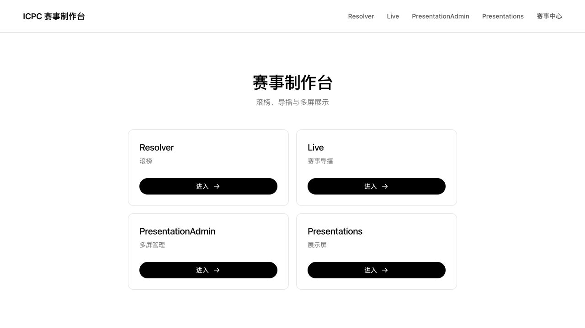
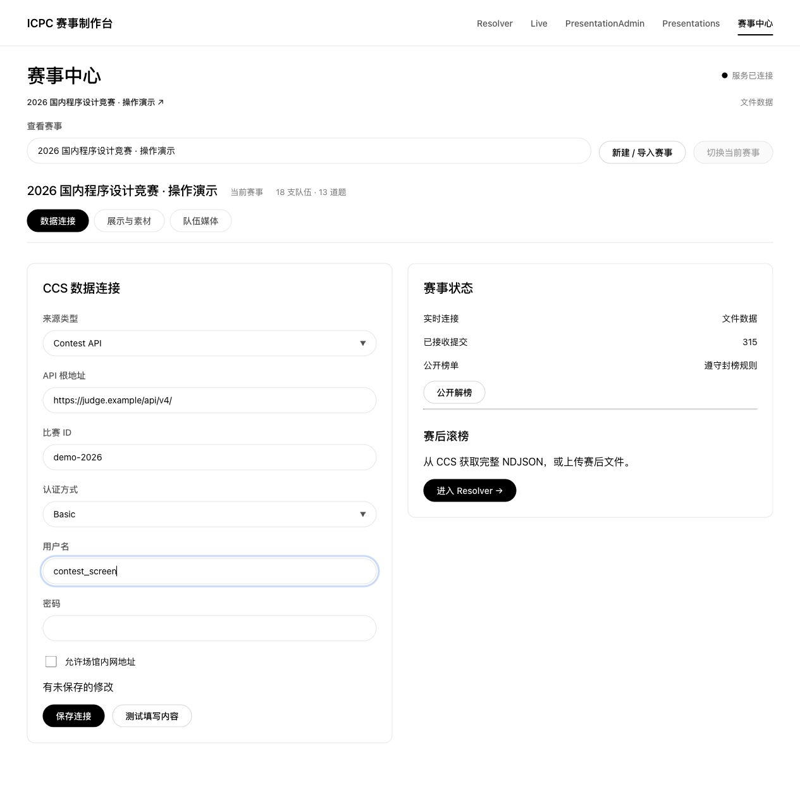
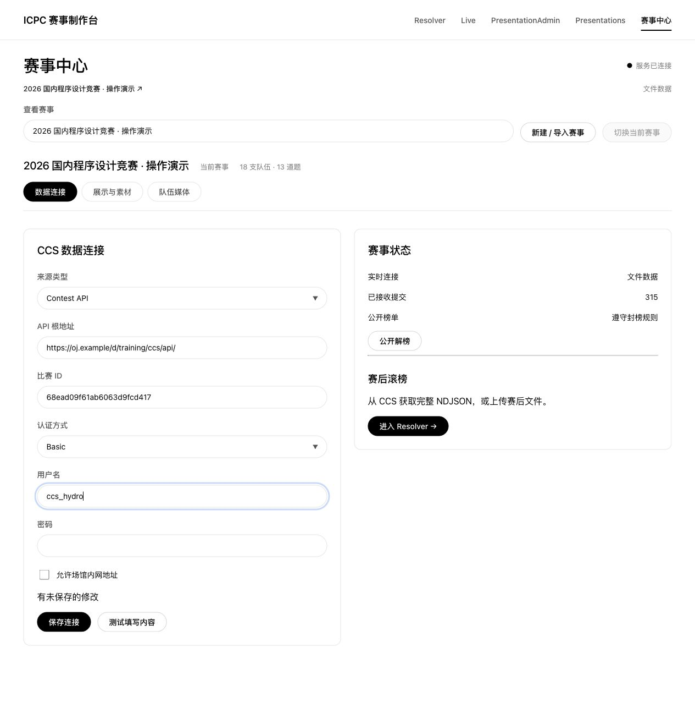
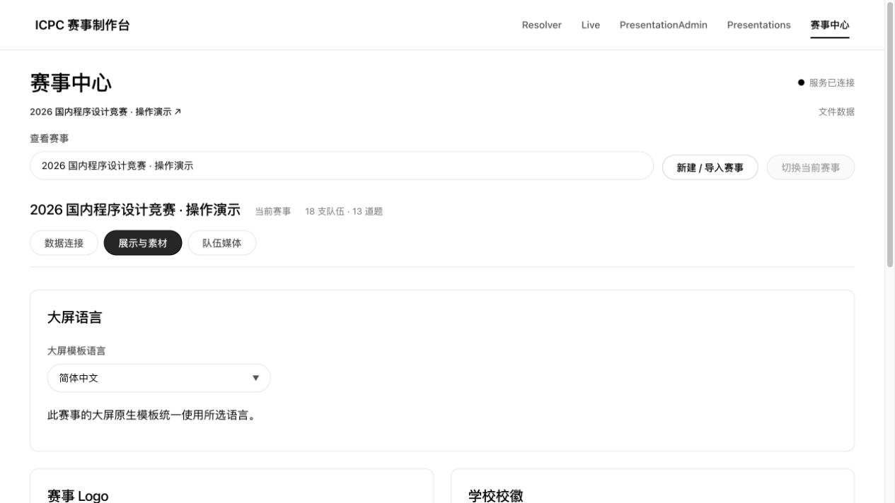
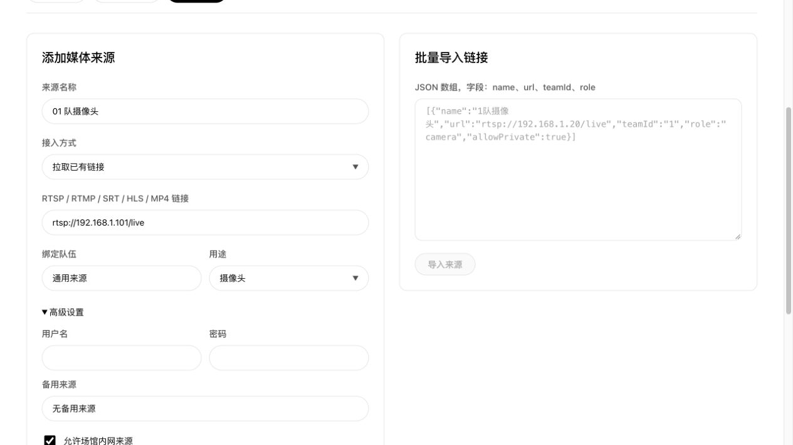
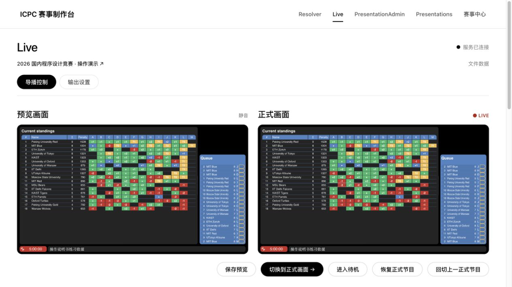
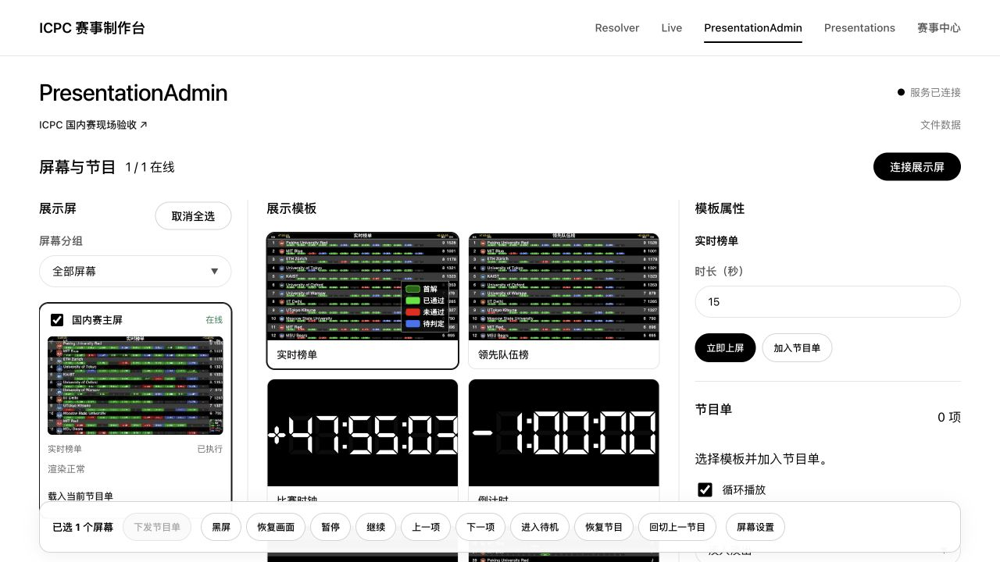
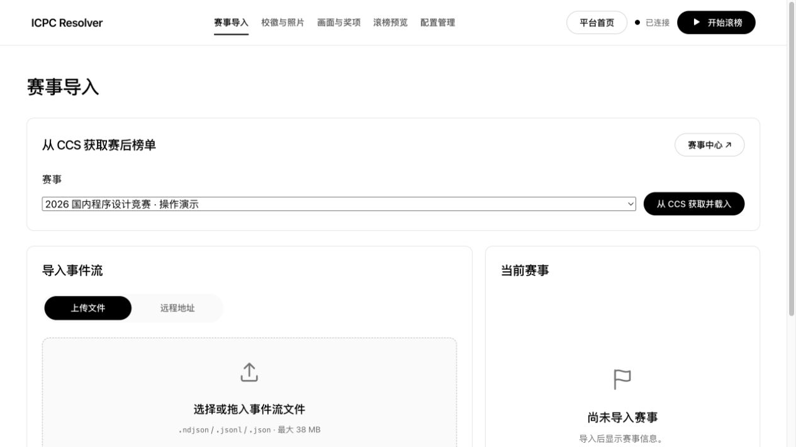
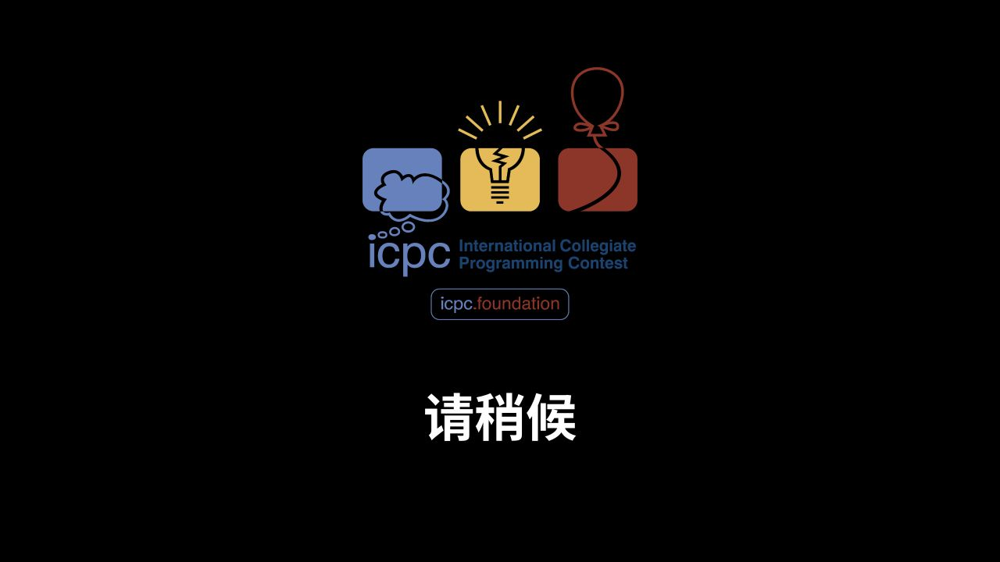

# ICPC 赛事制作台操作说明书

更新日期：2026-10-31。适用于 `codex/production-platform` 四模块分支；该分支仍沿用 1.3.0 包版本号，不代表已经发布新的稳定版本。

面向赛事管理员、导播、滚榜主持人和大屏操作员。本文中的域名、比赛 ID 和媒体地址均为填写示例，请换成现场实际值；界面截图使用合成练习数据。DOMjudge 与 Hydro 的接入依据官方接口说明及源码核对，具体权限以所部署版本为准。

[下载 PDF](使用指南.pdf) · [简明部署与开发说明](PLATFORM.md) · [示例榜单](../examples/README.md)

## 1. 入口与使用顺序

首页提供四个入口，赛事中心从顶部导航进入。

| 入口 | 用途 |
| --- | --- |
| Resolver `/resolver/` | 导入赛后完整数据，配置封榜、奖项和素材，手动滚榜。 |
| Live `/live/` | 编辑预览、切换正式节目，输出完整画面或透明叠加。 |
| PresentationAdmin `/presentation-admin/` | 配对、命名和分组屏幕，编排节目单并统一上屏。 |
| Presentations `/presentations/` | 展示电脑打开的页面，绑定后播放管理端下发的节目。 |
| 赛事中心 `/contest/` | 配置共享赛事、CCS 连接、公开封榜、语言、校徽、照片和媒体。 |



推荐顺序：部署平台 → 接入 DOMjudge 或 Hydro → 切换当前赛事 → 准备素材与媒体 → 排练导播和大屏 → 正式播出 → 赛后独立滚榜。

**实时接入只配置一次。** Live、PresentationAdmin 和 Presentations 共用当前赛事及一条服务端持续连接；管理页面不必保持打开。Resolver 在载入时复制独立快照，之后的实时判题、赛事切换和公共素材修改不会改变这场滚榜。

## 2. 部署与首次打开

### 2.1 完整部署

需要 Docker Engine 或 Docker Desktop，以及 Docker Compose。需要视频时使用完整 Compose，同时启动应用、MediaMTX 和 FFmpeg 工作服务。

```bash
git clone --branch codex/production-platform \
  https://github.com/Albert-Li-Sz/Resolver-Web.git
cd Resolver-Web
cp deploy/platform.env.example .env
```

编辑 `.env`，至少填写以下三项。两个密钥分别生成，不要直接使用示例文本。

```dotenv
RESOLVER_ADMIN_KEY=填写管理员密码
MEDIA_INTERNAL_KEY=填写另一段随机内部密钥
MEDIA_PUBLIC_HOST=192.168.1.10
RESOLVER_BIND_ADDRESS=0.0.0.0
RESOLVER_PORT=4173
MEDIA_BIND_ADDRESS=0.0.0.0
```

```bash
# 每次执行生成一段随机值，分别用于上面的两个密钥
openssl rand -hex 32
docker compose --env-file .env -f compose.platform.yaml up -d --build
docker compose --env-file .env -f compose.platform.yaml ps
curl -fsS http://127.0.0.1:4173/api/health
```

打开 `http://192.168.1.10:4173/`。管理端用户名固定为 `admin`，密码为 `RESOLVER_ADMIN_KEY`。CCS 账号在赛事中心另行填写，与平台管理密码不同。

`MEDIA_PUBLIC_HOST` 必须是展示电脑能到达的服务器地址，不能填写容器名、`localhost` 或 `127.0.0.1`。同一套系统建议统一使用一个 IP 或域名打开，避免浏览器身份与设置分散在不同站点。

### 2.2 网络与输出

| 端口 | 用途 |
| --- | --- |
| TCP 4173 | 平台网页、接口和状态事件流。 |
| TCP 8554 / 1935 | RTSP / RTMP 媒体接入。 |
| UDP 8890 | SRT 媒体接入。 |
| TCP 8888 / 8889 | HLS / WebRTC WHEP 浏览器播放。 |
| TCP、UDP 8189 | WebRTC 媒体传输。 |

默认面向场馆局域网。若网页通过 HTTPS 打开，媒体的 HLS、WHEP 地址也应配置为浏览器可访问的 HTTPS 地址，避免混合内容被拦截；反向代理与 SSE 设置见 [部署说明](部署说明.md)。只开放网页端口不足以完成 WebRTC 接入，媒体发布地址与网络路由也必须可达。

### 2.3 不使用视频的本地运行

```bash
npm ci
npm run build
npm start
```

打开 `http://127.0.0.1:4173/`。这种方式可使用赛事、Resolver、配对、大屏原生模板与无视频导播；视频网关需要按完整 Compose 部署。向其他电脑开放时，还需设置监听地址和管理员密码。

## 3. DOMjudge 接入

### 3.1 准备 API 账号与比赛

1. 在 DOMjudge 中完成比赛时间、封榜、题目、队伍和组织设置，确认比赛已启用。
2. 在用户管理中准备专用 API 读取账号。当前上游的事件流要求 `api_reader` 权限；`jury` 继承该权限。以本机版本的角色名称与 API 文档为准，不要使用只有队伍或 judgehost 权限的账号代替。
3. 打开本机 DOMjudge 的 `/api/doc`，确认 API 路径与比赛列表。当前上游同时提供 `/api/` 和 `/api/v4/`；安装在子路径时，保留该子路径。
4. 使用该账号读取 `contests`。**比赛 ID 复制响应中的 `id`**，不要用比赛名称，也不要把后台页面的内部编号直接当作 API ID。

```bash
# curl 会提示输入该 API 账号的密码
curl --fail --show-error --user contest_screen \
  'https://judge.example/api/v4/contests'
```

### 3.2 在赛事中心填写

打开“赛事中心”，点击“新建 / 导入赛事”，填写名称并点击“创建赛事”。在“数据连接”中填写：

| 字段 | DOMjudge 填写示例 |
| --- | --- |
| 来源类型 | Contest API |
| API 根地址 | `https://judge.example/api/v4/` |
| 比赛 ID | `demo-2026`，替换为 `contests` 返回的 `id`。 |
| 认证方式 | Basic |
| 用户名 / 密码 | 上一步创建的专用 API 账号。 |
| 允许场馆内网地址 | 来源为 10.x、172.16-31.x、192.168.x 等内网地址时勾选。 |

若 DOMjudge 位于 `https://judge.example/domjudge/`，根地址相应填写 `https://judge.example/domjudge/api/v4/`。

不要把 `/contests/demo-2026` 或 `/event-feed` 填入“API 根地址”。平台会自动拼接成：

```text
https://judge.example/api/v4/contests/demo-2026/event-feed
```



点击“测试填写内容”，通过后点击“保存连接”。新赛事还需点击“切换当前赛事”并确认，Live 和全部展示端才会使用它。新建、查看或编辑其他赛事，不会自动替换正在播出的赛事。

### 3.3 检查接入结果

观察“赛事状态”的实时连接、已接收提交数和公开榜单状态，并核对队伍数、题目数。正式比赛前，在练习赛提交一份测试代码，检查提交队列与判题变化是否到达。

连接测试只证明当前响应中存在有效事件，不等于封榜、所有题目、全部判题或现场网络已经验收。赛后获取完整数据时，账号还必须能读取封榜期间的判题结果。

DOMjudge 官方说明见 [API 文档入口](https://www.domjudge.org/docs/manual/main/develop.html#api)，角色与路由以本机 `/api/doc` 为准。

## 4. Hydro + CCS API 接入

### 4.1 安装插件并初始化比赛

本文对应 [hydro-dev/ccs-api](https://github.com/hydro-dev/ccs-api)。它为 Hydro 的 ACM / ICPC 比赛提供 Contest API；OI / IOI 计分比赛不适用于本平台的 XCPC 滚榜流程。

在 Hydro 的实际运行环境中安装并启用插件。下列是上游给出的全局安装方式；容器或自定义进程部署请在对应环境操作，并使用原有的重启方式。

```bash
yarn global add @frexdeveloper/hydrooj-plugin-ccs
hydrooj addon add @frexdeveloper/hydrooj-plugin-ccs
pm2 restart hydrooj
```

1. 进入 Hydro“控制面板 → 配置管理”，设置 CCS 插件的用户名和密码。它们是插件单独配置的凭据，不是 Hydro 网页登录账号。上游默认用户名为 `ccs_hydro`，实际填写值以配置为准。
2. 完成比赛时间、题目、参赛队伍、组织与赛制设置。
3. 使用具有系统管理权限的账号进入比赛详情，点击右侧“(CCS) 初始化比赛”。
4. 记录比赛详情 URL 中的比赛 ID。例如 `/contest/68ead09f61ab6063d9fcd417` 的 ID 为 `68ead09f61ab6063d9fcd417`。

**初始化后不要随意修改赛前配置。** 必须调整时，按上游说明重置并重新初始化 CCS 数据；这会重建事件历史，需要同步处理下游缓存和正在进行的连接。应在维护或排练时进行，不要把重置当成普通重连操作。

### 4.2 在赛事中心填写

| 字段 | Hydro 填写示例 |
| --- | --- |
| 来源类型 | Contest API |
| API 根地址 | `https://oj.example/ccs/api/` |
| 比赛 ID | `68ead09f61ab6063d9fcd417` |
| 认证方式 | Basic |
| 用户名 / 密码 | Hydro 控制面板中设置的 CCS 插件凭据。 |
| 允许场馆内网地址 | Hydro 使用内网地址时勾选。 |

若比赛位于 Hydro 的 `training` 域，根地址改为：

```text
https://oj.example/d/training/ccs/api/
```

平台据此连接：

```text
https://oj.example/d/training/ccs/api/contests/68ead09f61ab6063d9fcd417/event-feed
```



依次点击“测试填写内容”“保存连接”“切换当前赛事”，确认赛事名称、队伍、题目与提交数。上游插件支持的认证是 Basic；不要误选 Bearer。插件尚未实现 `scoreboard` 和 `awards` 并不妨碍这里通过事件流构建榜单，Resolver 中也可自行生成奖项。

### 4.3 赛后导出备用文件

优先使用 Resolver 的“从 CCS 获取并载入”。需要手动保存原始事件流时，可用 CCS 凭据下载有限事件流，待全部判题完成后再执行：

```bash
curl --fail --show-error --user ccs_hydro \
  'https://oj.example/ccs/api/contests/68ead09f61ab6063d9fcd417/event-feed?stream=false' \
  --output event-feed.ndjson
```

特定域比赛需相应加入 `/d/域ID/`。DOMjudge 也可从其事件流接口使用 `stream=false` 下载。不要在赛中使用这个有限模式代替持续直播连接。

若 Hydro 本身提供比赛 CDP 包导出，也可解压后取出 `event-feed.ndjson` 手动上传。不要上传整个 ZIP 或只有汇总分数的 CSV；用于滚榜的文件必须包含完整提交与判题。

## 5. 共享赛事、封榜与素材

### 5.1 管理多场比赛

“查看赛事”用于编辑指定工作区；“当前赛事”才是 Live 和大屏正在使用的赛事。保存未启用赛事的连接不会抢占当前赛事，点击“切换当前赛事”才统一生效。

“停止连接”保留地址、凭据和已有数据；“重新连接”继续接收。修改当前赛事的地址、来源类型或比赛 ID，会确认替换数据源并重建实时数据，同时清除旧队伍、媒体引用和回切记录。仅修改凭据或停止、恢复连接不等于更换赛事。

已有完整文件也可通过“新建 / 导入赛事”直接上传 NDJSON，作为静态共享赛事；它不会自动变成持续连接。

### 5.2 封榜与公开解榜

默认在服务端执行赛事封榜规则，实时榜单、提交队列、首解和统计共用公开数据。赛事中心的“公开解榜”会使封榜判题对实时观众公开，需要确认影响范围并勾选“确认公开封榜判题”。

“恢复封榜规则”恢复后续公开视图的过滤，不能收回观众已经看到的结果。**赛后获取完整滚榜数据不需要先点击“公开解榜”**，也不会自动解榜或推进 Resolver。

### 5.3 中文、Logo 与照片

进入“展示与素材”，设置“大屏模板语言”、赛事 Logo、学校校徽与队伍照片。新赛事默认简体中文，旧赛事默认英文；原生模板和管理端缩略图一起更新。队伍名、学校名、题号、自定义公告不翻译，Live 与 Resolver 原有固定文案不受影响。



学校按名称与别名自动适配 Hydro 校徽库，未匹配或加载失败使用 ICPC 官方 Logo。手工替换时按实际对象选择学校或队伍；队伍可设置独立 Logo 与照片。素材归属于所选赛事。

Resolver 载入时复制素材，可为本次颁奖独立调整；这些修改不反向覆盖共享赛事。赛前缓存当前滚榜需要的远程校徽和照片，并在实际展示电脑断开公网时检查。

### 5.4 其他事件流与认证

已有标准 NDJSON 持续服务时，将“来源类型”改为“持续 NDJSON 事件流”，在“事件流地址”填写完整 URL；此模式不再填写比赛 ID，也不会自动拼接路径。直播来源保持持续模式，不附加 `stream=false`。

只有上游明确采用 Bearer 时才选择 Bearer，并填写“Bearer Token”；公开来源可选“无认证”。DOMjudge 与本文 Hydro CCS 插件使用 Basic。已保存密码或令牌在编辑时留空表示保留，切换认证方式只填写对应字段。

## 6. 队伍摄像头、桌面与音频

### 6.1 添加已有来源

进入“赛事中心 → 队伍媒体”，填写“来源名称”，选择“拉取已有链接”，输入 RTSP、RTMP、SRT、HLS 或 MP4 地址。选择“绑定队伍”和“用途”：摄像头、桌面、音频。

高级设置可填写来源用户名、密码、备用来源、允许场馆内网来源及“兼容转码”。有凭据的拉流地址应使用单独的用户名、密码字段；不要把账号密码直接嵌入 URL。内网勾选允许的是场馆私网地址，不能因此把容器内的 `localhost` 当作摄像头地址。



点击“添加来源”或“保存来源”，再使用来源列表中的“检测”，并结合 Live 诊断面板检查网关与来源。相同来源共享网关任务，只打开正在使用的媒体；不必为每块屏幕重复添加相同摄像头。

浏览器优先 WebRTC / WHEP，失败后回退 HLS。HLS 通常延迟更高；有声音没图、编码不兼容或无法直接播放时，尝试启用“兼容转码”，同时观察服务器负载。

### 6.2 生成发布地址与批量导入

若设备或采集软件主动推流，选择“生成推送地址”保存，然后在来源列表查看 RTMP、RTSP 或 SRT 发布地址。将完整凭据保留在发送设备中，按发送软件的字段要求填写；发布令牌不要分发给观众。

“批量导入链接”接受 JSON 数组。`teamId` 使用已导入赛事的真实队伍 ID，`role` 使用 `camera`、`desktop` 或 `audio`。

```json
[
  {"name":"01 队摄像头","url":"rtsp://192.168.1.101/live","teamId":"team-01","role":"camera"},
  {"name":"01 队桌面","url":"rtsp://192.168.1.102/live","teamId":"team-01","role":"desktop"}
]
```

### 6.3 替换与备用源

重命名不会打断拉流；修改地址、凭据或转码等连接参数后重新连接。删除来源会停止对应播放器和网关任务，固定引用显示占位画面。

正在正式播出或被上一正式场景引用的来源，替换和删除前会提示影响范围。故障时在 Live 点击“预览备用源”或“预览备用音频”，确认预览后再切换正式画面；健康告警不会自动替你切换节目。

## 7. Live 导播

### 7.1 预览到正式画面

进入 Live 的“导播控制”。预览和正式画面始终并排显示，预览默认静音。

1. 选择“单队伍”“双队伍对比”或“四分屏”。
2. 搜索并选择各位置的队伍，确认关联的摄像头、桌面和来源；需要时手工选择“视频来源”。
3. 设置字幕、滚动消息、图片、叠加组件和音量。
4. 检查预览，点击醒目的“切换到正式画面”。只有此操作才将预览配置用于正式输出。



修改预览不会直接上屏，后台实时判题也不会覆盖尚未提交的编辑。切换前始终核对队伍、音频和实际预览，尤其是多个来源名称相似时。

### 7.2 组件与布局预设

叠加组件包括榜单、时钟、提交队列、首解提示、队伍信息、字幕、滚动消息和图片。勾选决定显示，展开“位置”调整横纵坐标；位置调整仍属于预览，需要切换正式画面后生效。

字幕和滚动消息在对应输入框编辑；图片可填写地址或点击“上传图片”。“保存预览”只保存导播草稿，不等于已经切换正式节目。

常用布局可保存预设。载入已有预设后，“更新预设”修改原项；“另存为”保存另一套，避免重复创建同名布局。切换赛事保留布局类型，但旧赛事的队伍与媒体引用会清理，使用前重新选择。

### 7.3 音量与应急

“正式输出音量”和“独立音频来源”属于场景设置，先在预览调整，再切换到正式画面。输出电脑第一次仍需启用声音；管理页面无法绕过浏览器自动播放限制。

“进入待机”影响独立正式输出及 Live 适配屏，显示赛事 Logo 和“请稍候 / Please stand by”，停止正式视频与声音，并清空透明叠加。预览可继续编辑。

“恢复正式节目”恢复进入待机前的正式场景；“回切上一正式节目”恢复上一套正式场景并消耗一层记录。两者都不覆盖预览草稿，待机本身不覆盖回切记录。同一输出页面已启用的声音状态在恢复后保留。

## 8. OBS 输出与 LED 画面

### 8.1 配置输出链接

在 Live 打开“输出设置”，选择“正式画面”或“透明叠加”，分别设置分辨率、比例、安全边距和输出区域，点击“保存输出规格”，再复制对应链接。

| 输出 | 在 OBS 中的用途 |
| --- | --- |
| 正式画面 | 包含节目布局、视频和图形的完整画面，作为浏览器源。 |
| 透明叠加 | 仅显示相应图形，叠放在 OBS 的其他视频源上方。 |

在 OBS 添加浏览器源，粘贴复制的完整地址；URL 的 `#` 后面包含输出令牌，不能省略。令牌是观看该输出的凭据，不是平台管理密码。

默认 2K 的 16:9 对应 2560×1440；1080p 为 1920×1080，4K 为 3840×2160。自定义比例时按实际宽高设置 OBS 浏览器源，并先用校准画面检查；提高渲染分辨率不能增加输入视频本身的细节。

链接中的 `clean=1` 始终输出纯画面，不显示控制栏、恢复热区或管理通知。透明叠加待机时清空，正式画面则显示待机 Logo。

### 8.2 特殊比例与换链

32:9 LED、半屏、四分屏和自定义区域使用“画面比例”“输出区域”及安全边距组合配置。先确认 LED 控制器映射，再检查四角、文字与图形，不要只通过拉伸网页适配屏幕。

“重新生成输出链接”会同时使旧正式画面和透明叠加链接失效，需更新所有 OBS 浏览器源。它不解除已配对的展示屏，也不使通过展示屏身份播放的 Live 适配器失效。

OBS 负责最终录制、编码与平台推流。本项目不在服务器端最终合成或录制；正式使用前应在现场 OBS 中检查画面、声音、待机恢复和重新连接。

## 9. 配对与管理展示屏

### 9.1 连接一块屏幕

1. 展示电脑打开 `/presentations/`，出现 8 位链接码，10 分钟内有效。
2. 管理电脑进入 PresentationAdmin，点击“连接展示屏”，输入链接码与名称，例如“主舞台 LED”。
3. 配对成功后，屏幕列表显示该名称、在线状态和实际回传画面；展示电脑进入播放页面。



链接码仅用于首次绑定，成功后失效；长期绑定由展示浏览器保存。收藏绑定后的屏幕地址，刷新、服务重启后可恢复名称与节目。清除浏览器站点数据、换浏览器或解除绑定后需重新配对。

同一浏览器需要多个独立屏幕时，点击“新建屏幕”创建新身份，分别保存地址。不要把同一个绑定地址当成多个可独立控制的屏幕使用。

### 9.2 选择范围与设置

勾选单块、多块屏幕，或按分组选择。底部固定显示已选数量；“立即上屏”“下发节目单”、黑屏和应急按钮都作用于所选屏幕。

在“屏幕设置”中修改名称、分组和输出规格，可对多选屏幕批量配置。输出规格各屏独立保存，不会自动修改 Live 的独立 OBS 输出。

解除绑定前会确认影响范围；完成后该展示端失去原绑定权限，需重新配对。命令状态以实际屏幕回执为准，不要只凭按钮提示认定已经上屏。

### 9.3 展示电脑本机操作

在本机点击“全屏”和“启用声音”。全屏失败时控制栏保持可见，并显示原因。

点击“隐藏控制栏”后，首次提示说明恢复方法：按 **H** 或点击右上角透明热区。普通鼠标移动和触摸不会重新打开；节目切换、刷新和重连保留该屏幕的隐藏状态。

“新建屏幕”、声音与全屏是本机操作；管理端负责之后的节目切换。刷新后浏览器可能要求再次点击启用声音。

## 10. 模板与节目单

### 10.1 原生模板

| 模板 | 使用方法 |
| --- | --- |
| 实时榜单 | 显示当前公开排名、通过数与罚时，遵守赛事封榜。 |
| 领先队伍榜 | 展示领先队伍，适合主舞台间歇播出。 |
| 比赛时钟 | 使用赛事时间，跟随最新公共比赛状态。 |
| 倒计时 | 设置目标日期和时间，用于开赛、入场或仪式。 |
| 判题队列 | 展示公开提交及判题状态，封榜结果不会提前出现。 |
| 首解列表 | 展示公开首解记录，首解用时与榜单罚时分别表达。 |
| 队伍介绍 | 在属性中选择队伍，显示其信息与已配置素材。 |
| 赛事 Logo | 使用赛事中心保存的赛事标志。 |
| 图片轮播 | 填写图片地址或上传图片，作为赛事宣传与赞助展示。 |
| 文字公告 | 在属性中填写要显示的文字。 |
| 屏幕校准 | 检查比例、四角、安全边距与显示区域。 |

另提供两个适配器：“Resolver 观众画面”跟随当前正式滚榜，“Live 正式画面”跟随 Live 导播。语言切换只翻译原生模板，不改写适配器中的既有画面。

### 10.2 立即上屏与编排

选择屏幕，再选择模板卡片并填写右侧属性。点击“立即上屏”直接使用这项模板；“加入节目单”只加入编辑列表，不立即打断现场。

按节目单中的顺序调整项，逐项设置时长，选择循环与“直接切换 / 淡入淡出”。检查后点击“下发节目单”，多块屏幕按服务器预约时间同步生效。

保存节目单后，可从“已保存的节目单”载入。修改原项使用更新保存，“另存为”创建另一份；**保存不等于已经下发**，编辑后的内容需再次下发才上屏。“载入当前节目单”可将屏幕当前配置放回编辑区继续调整。

### 10.3 播放控制与回切

底部提供暂停、继续、上一项和下一项。暂停节目单不会冻结实时榜单数据，也不会让比赛时钟停止推进。

每块屏幕只保留一层上一套已上屏节目。点击“回切上一节目”沿原来的时间轴继续，成功后记录被消耗；原本暂停的节目保持暂停。刚下发但尚未真正生效的目标不会被误记为上一节目。

## 11. Resolver 赛后获取与导入

### 11.1 从 CCS 获取

比赛结束、全部判题与重判完成后，打开 `/resolver/`，在“从 CCS 获取赛后榜单”中选择已配置赛事，点击“从 CCS 获取并载入”。无需在赛事中心先公开解榜。

平台显示事件数量与获取进度，提供“取消获取”。Contest API 来源读取赛后资源并复核提交和判题是否仍在变化；持续 NDJSON 来源还需确认结束状态及完整性，不把连接关闭简单当作完整标志。



成功后确认替换当前配置，并点击“下载 NDJSON”留存原文件。账号缺少封榜判题权限、比赛未结束、判题仍变化或数据不完整时，获取会失败并保留原滚榜数据；修正后重试或改为手动上传。

得到的完整 NDJSON 可能包含尚未向现场公开的成绩，应作为赛事内部资料保管。下载或载入不会改变赛事中心的公开封榜状态。

### 11.2 手动导入与素材

从“上传文件”选择 `.ndjson`、`.jsonl` 或 `.json`，上限 38 MB。练习文件见仓库 `examples/`；ZIP 先解压，CSV、Excel 或截图无法重建逐题滚榜。

原“远程地址”入口用于 HTTP(S) 文件，不替代带凭据的共享 CCS 接入。该旧入口默认限制公网 80/443，精确内网来源由部署端的 `RESOLVER_FEED_ORIGINS` 配置；赛事中心的“允许场馆内网地址”是另一套连接配置，不能互相代替。

“校徽与照片”可按组织、队伍名称或 ID 配置素材，重名时优先使用 ID；ID 规则优先于名称。校徽自动适配失败时使用 ICPC Logo。点击“缓存当前赛事素材”，检查未匹配和缓存失败的报告。

## 12. Resolver 奖项、排练与正式滚榜

### 12.1 画面、封榜与奖项

“画面与奖项”设置每屏行数、行偏移、开场画面、标题及 1080p / 2K / 4K。默认读取数据中的封榜；若赛后源已经解封，可手工还原封榜时长。例如 5 小时比赛最后 60 分钟封榜，填写 60 分钟。

| 奖项 | 配置与规则 |
| --- | --- |
| 金、银、铜牌 | 自定义名额和名称，0 表示关闭；并列跨奖线按已选同分规则处理，实际人数可能增加。 |
| 冠、亚、季军 | 可自动生成，名称可修改；按最终榜单顺序取前三支正式队伍，可与金银铜并存。 |
| 各题最快解题奖 | 选择全部或指定题目，按最早 AC 的比赛时间计算，不含罚时；完全同一时间可共同获奖。 |
| 事件流奖项 | 可沿用并选择忽略；自定义生成同类奖项会替换对应事件流奖项。 |

打星队伍不占正式名次和奖牌名额；最快解题奖可单独选择是否包含打星队伍。无 AC 或存在影响首解判定的未判题时，相关奖项不会贸然生成。点击“查看获奖名单”核对所有实际获奖队伍，再开始正式滚榜。

### 12.2 排练、预设与主持

“滚榜预览”使用正式引擎，支持下一步、上一步、回到开头和刷新预览；不会发布观众进度。完成排练后在“配置管理”保存当前配置，确认是否包含赛事数据。

配置管理支持保存、载入和删除预设；服务端保存的预设可在同一部署的其他浏览器载入。载入需确认替换，“撤销载入”可恢复上一份赛事、选项与手动素材。当前浏览器草稿不能代替完整数据备份。

“开始滚榜”打开独立主持端。主持端鼠标与键盘控制如下：

| 操作 | 控制 |
| --- | --- |
| 下一步 | 画布右键、→、↓、PageDown、空格或 Enter。 |
| 上一步 | 画布左键、←、↑、PageUp 或 Backspace。 |
| 开头 / 结尾 | Home / End。 |
| 重置 / 全屏 / 帮助 | R / F / ?。 |
| 关闭帮助 / 退出全屏 | Esc。 |

首次点击会较快滑至底部。启用活动奖项后，系统从最靠下获奖队伍的封榜位置开始进入正常揭晓，此前动作以 4 倍速快速掠过；可暂停快进，到奖项区后恢复手动推进。没有活动奖项时从底部手动滚榜。

主持端与新平台展示端是不同控制方式：Resolver 播放器原有工具栏行为保留；Presentations 和 Live 输出隐藏控制栏后用 H 或右上角热区恢复。

### 12.3 观众与恢复

对外提供 `/view`，自动等待并接入当前正式滚榜；`/view?id=...` 只观看指定场次，旧观众链接继续有效。不要把带控制权限的主持链接发给观众。

观众跟随前进、回退、重置和颁奖，晚加入或刷新后同步已公开进度，不提前获得未来判题。跨电脑分享使用服务器 IP 或域名，不使用 localhost。

接屏电脑按 C 打开原 Resolver 的画面设置，调整分辨率、区域、比例与安全边距，用校准图确认后退出。这些本机显示设置不推进主持进度。

主持电脑或服务重启后，回到配置中心点击“继续上次滚榜”，核对已恢复进度后再推进。恢复后保持暂停；新实时事件不会重算已经开始的独立滚榜。

## 13. 现场应急与健康监测

### 13.1 三种操作的区别

| 操作 | 现场效果 |
| --- | --- |
| 黑屏 / 恢复画面 | 只控制所选大屏的遮黑，不替换节目，也不清除回切记录。 |
| 进入待机 / 恢复节目 | 大屏显示赛事 Logo 与固定待机文字；恢复时沿原时间轴继续，暂停状态保留。 |
| 回切上一节目 | 返回上一套已经上屏的内容，仅一层，成功后消耗记录。 |

Live 的应急按钮影响 Live 正式输出及 Live 适配屏；PresentationAdmin 的应急按钮只影响已选屏幕。黑屏优先于待机；屏幕仍黑时先检查“恢复画面”。输出规格与节目回切相互独立。



大屏应急切换采用 750ms 预约同步并直接切换。退出待机不是从头重播：经过的时间继续计算；比赛时钟和榜单读取最新公开数据。切换赛事或替换 CCS 数据源会清除旧回切记录。

### 13.2 看懂健康状态

| 指标 | 含义与处理 |
| --- | --- |
| 屏幕在线 | 每 5 秒心跳，超过 15 秒未收到判离线；先检查展示电脑与网络。 |
| 渲染正常 / 异常 | 在线前台渲染循环超过 5 秒未推进时提示异常，检查浏览器卡顿与显卡负载。 |
| 视频断帧 / 重连 | 约 6 秒无新视频帧触发断帧处理；查看实际协议、分辨率、帧率与来源状态。 |
| 缩略图陈旧 | 超过 20 秒未更新或捕获失败；结合渲染与心跳判断，不把旧图当作当前画面。 |
| 后台 / 静态 / 旧客户端 | 分别标识，不简单判作渲染停滞；首次载入有 15 秒宽限。 |
| 状态上报失败 | 网络恢复后继续重试，成功上报即清除提示；不需要为此更换节目。 |

屏幕卡片和 Live 诊断供管理员查看。媒体指标包含实际播放协议、重连和转码状态，不向普通展示端公开来源凭据。健康告警只提示，不自动切换正式节目。

公开解榜、切换赛事、替换数据源、解绑、轮换输出链接、替换或删除正式媒体都有确认弹窗。取消、Escape 和关闭都不提交；控制版本冲突时先刷新核对现场，避免重复点击。

## 14. 比赛当天与重启恢复

### 14.1 开场前

1. 使用实际服务器地址、展示电脑和 LED 比例打开系统，检查所有屏幕名称与分组。
2. 在练习赛测试一次提交、判题、封榜、首解和时钟，核对当前赛事。
3. 缓存素材，核对学校校徽、照片、中文字幕和长队名。
4. 每台展示电脑启用全屏与声音，确认真实回传，不只看在线标记。
5. 排练预览到正式切换、备用源、待机、黑屏与单层回切。
6. 在现场 OBS 检查完整画面、透明叠加、声音和录制或推流设置。

### 14.2 断网、重启与备份

暂时断网时，展示端保留当前内容并继续运行已缓存节目单；时钟按已校准时间推进，断开的媒体使用占位。恢复后应用最新节目状态，不重放过时命令。

应用数据卷保存工作区、屏幕绑定、节目、输出配置、待机与回切记录，以及已发布的 Resolver 进度。媒体服务重启后按需重建连接；管理浏览器重开后核对实际画面再操作。展示电脑刷新仍可能需要本机重新启用声音。

升级时保留同一个 Compose 项目名与 `resolver-data` 数据卷，不执行 `down -v`。除赛事文件外，还需备份完整数据目录与私有 `.env`。以下示例在暂停应用后复制数据，避免复制到写入一半的文件：

```bash
mkdir -p backup/2026-10-31
docker compose --env-file .env -f compose.platform.yaml stop resolver
docker compose --env-file .env -f compose.platform.yaml \
  cp resolver:/app/data/. backup/2026-10-31/
docker compose --env-file .env -f compose.platform.yaml start resolver
```

备份期间展示端暂时离线。恢复应在维护窗口进行，先保存当前卷，保留文件权限并确认容器用户可以读写，再核对原链接、屏幕绑定、节目和滚榜进度。比赛进行中不升级。

## 15. 常见问题

| 现象 | 检查与处理 |
| --- | --- |
| DOMjudge 返回 401 / 403 | 核对 Basic 账号、密码和 API 读取权限，不使用队伍或 judgehost 账号代替。 |
| Hydro 返回 403 | 同时检查 CCS 插件凭据及是否已初始化；上游可能用同一状态码报告这两类问题。 |
| 返回 404 或比赛不存在 | 检查 API 根路径、比赛 API ID、Hydro 的域路径，以及比赛是否启用。 |
| 返回网页 HTML 或 301 / 302 | 使用直接返回接口数据的最终地址，勿填写登录页或依赖跳转的入口。 |
| 提示来源地址不允许访问 | 确认是场馆私网后勾选允许内网；容器内 localhost 不是另一台服务器。 |
| 浏览器能打开，服务端不能连接 | 请求由应用服务器发起；检查容器 DNS、路由、防火墙与证书。 |
| 连接显示正常但没有新提交 | 核对当前赛事和比赛 ID，确认使用持续事件流、代理未缓冲，并在练习赛提交测试。 |
| 保存了赛事却未上屏 | 点击“切换当前赛事”；保存其他赛事不会自动替换当前赛事。 |
| 测试通过但赛后获取失败 | 检查比赛结束状态、未判题与重判、完整判题权限；失败时保留原数据，可重试或上传完整文件。 |
| Hydro 没有 scoreboard / awards | 该插件未提供这些接口；这里由事件流构榜，并在 Resolver 中配置奖项。 |
| 重置 Hydro 后数据混乱 | 重建了 CCS 事件历史；同步重建下游工作区或数据来源，勿继续沿用旧事件缓存。 |
| 页面 HTTPS 下视频不播放 | 检查媒体 HLS / WHEP 是否也通过 HTTPS 提供，以及浏览器混合内容提示。 |
| 视频一直占位或自动回退 HLS | 检查来源、网关端口、服务器广播 IP、编码和诊断；需要时启用兼容转码。 |
| 有画面没有声音 | 检查本机启用声音、正式音量、独立音轨及 OBS 音频设置；预览默认静音。 |
| 大屏一直黑 | 检查是否仍处于黑屏、是否选中正确屏幕、节目执行回执及输出区域。 |
| 退出待机后画面位置变了 | 节目按实际经过时间继续，并非从待机前的帧冻结恢复；暂停节目保持原暂停状态。 |
| 隐藏后找不到控制栏 | 按 H 或点击右上角透明热区；clean 输出始终不显示控制栏。 |
| 改了模板、节目单但现场没变 | 编辑或保存不等于下发，检查已选屏幕数量并重新点击“立即上屏”或“下发节目单”。 |
| 提示内容已更新 | 另一个管理员修改了相关控制状态；刷新后检查现场，不连续重复提交。 |
| OBS 旧链接失效 | 确认是否重新生成了输出链接，复制包含完整片段令牌的新链接到 OBS。 |
| 服务重启后找不到原屏幕 | 核对数据卷与 Compose 项目名；展示端是否更换浏览器、域名或清除了站点数据。 |
| PDF 与页面按钮不同 | 先确认运行四模块分支。旧 v1.3.0 发布镜像只对应原 Resolver，不能用它验证本手册全部功能。 |

## 16. 参考与适用范围

以下是本文核对的上游与项目资料，接口细节应以现场安装版本为准：

- [DOMjudge 官方 API 说明](https://www.domjudge.org/docs/manual/main/develop.html#api)，以及本机 `/api/doc`。
- [DOMjudge API 路由](https://github.com/DOMjudge/domjudge/blob/main/webapp/config/routes/api.yaml)、[认证与角色](https://github.com/DOMjudge/domjudge/blob/main/webapp/config/packages/security.yaml)、[赛事与事件流](https://github.com/DOMjudge/domjudge/blob/main/webapp/src/Controller/API/ContestController.php)。
- [Hydro CCS API 安装与初始化](https://github.com/hydro-dev/ccs-api)、[插件配置](https://github.com/hydro-dev/ccs-api/blob/main/index.ts)、[认证实现](https://github.com/hydro-dev/ccs-api/blob/main/handler/base.ts)、[有限与持续事件流](https://github.com/hydro-dev/ccs-api/blob/main/handler/event-feed.ts)。
- [平台部署、媒体与开发](PLATFORM.md)、[示例事件流](../examples/README.md)、[现场保护与中文化验收记录](ONSITE-VALIDATION.md)。

当前目标是场馆局域网、单实例应用、十个展示端和正式画面最多四路 1080p 视频；不提供公网穿透、TURN、服务器最终合成推流或录像回放。手册包含配置步骤，不代表任意上游版本或真实场馆已经完成联调。

当前开发分支的本地功能与回归结果见验收记录。OBS 原生接入和真实场馆验收仍保留未完成门槛，推送源代码与说明书不等于发布稳定版本。
